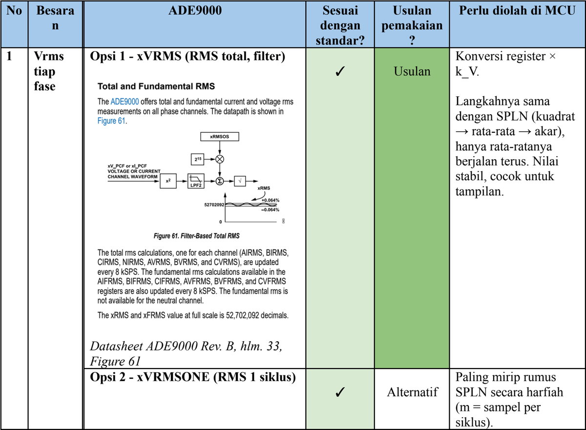
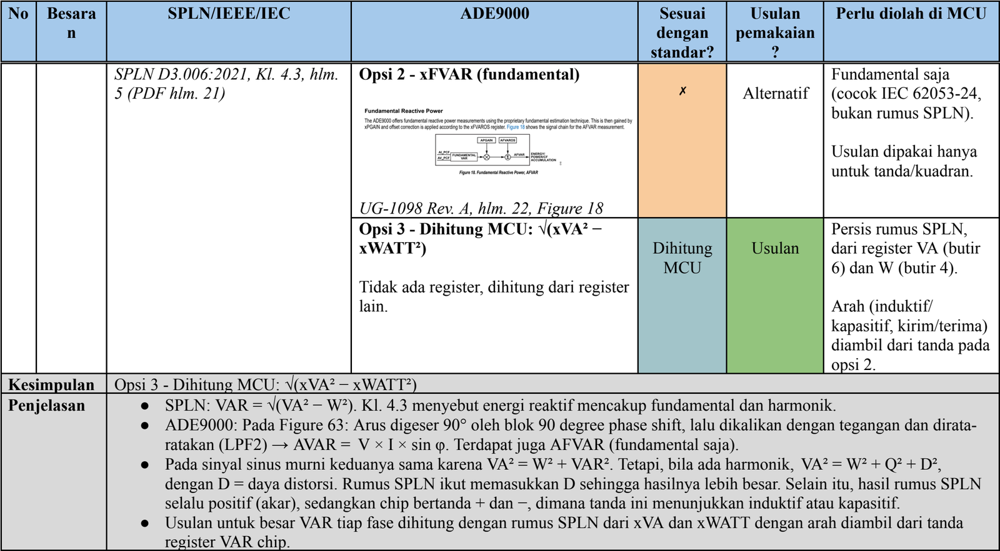

# Daily Journal – 23/11/2026

Bramantio Ananda – Metrology, Smart Meter 3-Phase AMI
Task: Activity #5 – Comparing metrology calculations on the ADE9000 with the reference standard (SPLN D3.006:2021)

## 1. Today's Work Plan

- Compare how the ADE9000 calculates each metrology quantity with the formulas in SPLN D3.006:2021 Clause 8.
- For each quantity, write every calculation option available on the ADE9000 (register or method), check whether each option matches SPLN, propose which option to use, and note what the MCU still has to process.
- Fill the results into the team document "Perbandingan metode pengukuran antara ADE & Standar".

## 2. Activities

08:00 23/11/2026 Daily team meeting via Google Meet.

08:25 23/11/2026 Reviewed the comparison table format and the sources used: SPLN D3.006:2021 Clause 8, ADE9000 Data Sheet Rev. B and User Guide UG-1098 Rev. A.

08:50 23/11/2026 Vrms per phase and Irms per phase: wrote the four ADE9000 options (xRMS filter-based, xRMSONE 1 cycle, xRMS1012 10 cycles, xFRMS fundamental only), their match with SPLN, and the proposed option (xRMS).

09:40 23/11/2026 Vrms line-to-line: the ADE9000 has no line-to-line RMS register in 4-wire wye mode, so the MCU computes it from the waveform buffer by subtracting simultaneous samples (v_R − v_S) and taking the RMS, which is the same as the SPLN formula.

10:15 23/11/2026 Active power (W) per phase and total: options xWATT (total = fundamental + harmonics), xFWATT (fundamental) and PWATT_ACC/NWATT_ACC. The chip gives signed values while SPLN requires non-negative W per phase, so the MCU stores the magnitude in the delivered (kirim) or received (terima) register. W total is not available as a register and is summed by the MCU.

11:10 23/11/2026 Apparent power (VA) per phase and total: xVA = xIRMS × xVRMS matches SPLN (VNOM option must stay disabled); VA total is the arithmetic sum of the three phases, computed in the MCU.

13:00 23/11/2026 Reactive power (VAR) per phase and total: xVAR (90° shift) and xFVAR (fundamental) do not match the SPLN formula √(VA² − W²) when harmonics are present. Proposed: the MCU computes √(VA² − W²) and takes the direction from the sign of xFVAR.

14:00 23/11/2026 Active energy (Wh): options xWATTHR, xFWATTHR and PWATT_ACC/NWATT_ACC; accumulation mode (WATTACC), register overflow (106.3 s at full scale, read on every EGYRDY) and separation per phase, direction and tariff in the MCU.

15:00 23/11/2026 Reactive energy (VARh) and apparent energy (VAh): VARh has to be accumulated by the MCU from the SPLN-style VAR; xVAHR matches SPLN for VAh.

15:45 23/11/2026 Power factor per phase and total: xPF = ΣxWATT / ΣxVA over 1.024 s matches SPLN per phase; PF total = W total / VA total is computed in the MCU, not as the average of the three phase PFs.

16:30 23/11/2026 Rechecked every row so each explanation covers both the SPLN formula and the ADE9000 method, then updated the team document.

Vrms per phase: ADE9000 options, match with SPLN, proposed use and MCU processing (SPLN column not shown).

VAR per phase: options 2 and 3, conclusion and explanation.

## 3. Comments, Questions, Complaints

- The word "Total" means different things in the two documents. In the ADE9000 documents "Total Active Power" means fundamental + harmonics, while in SPLN "W total" means the sum of the three phases. This is easy to confuse, so I noted it in the W total row.
- Several SPLN quantities have no ADE9000 register (W, VA and VAR totals, PF total, and VAR with the SPLN formula), so the MCU has to compute them. The reactive power method needs a team decision: the SPLN formula √(VA² − W²) or the fundamental-only definition (IEC 62053-24).
- Question: for the average power factor (Wh total / VAh total), should Wh total be delivered energy only, or delivered and received combined?
- Target for tomorrow: finish the comparison for the remaining quantities (phase angle, THD, TDD and frequency) and recheck all rows that are already written.
