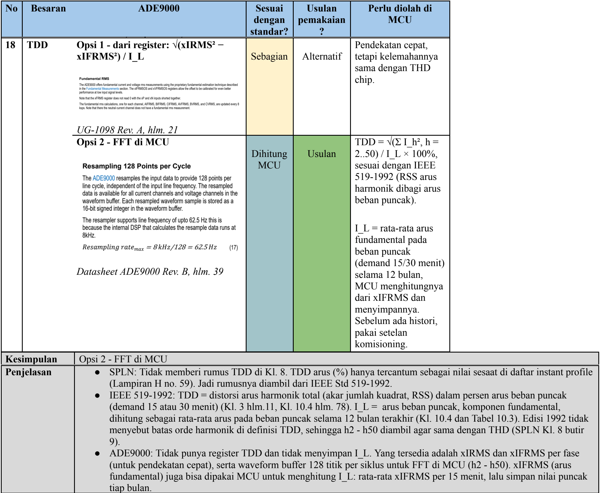
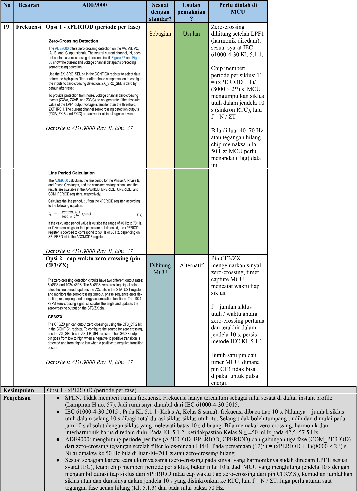

# Daily Journal – 24/11/2026

Bramantio Ananda – Metrology, Smart Meter 3-Phase AMI
Task: Activity #5 – Comparing metrology calculations on the ADE9000 with the reference standard (SPLN D3.006:2021)

## 1. Today's Work Plan

- Finish the comparison for the remaining quantities: average total power factor, phase angle, THD, TDD and frequency (rows 15–19).
- For quantities that SPLN D3.006:2021 lists without a formula (TDD and frequency), find the reference method in other standards.
- Recheck all rows (1–19) of the team document "Perbandingan metode pengukuran antara ADE & Standar" and fix any errors.

## 2. Activities

08:00 24/11/2026 Daily team meeting via Google Meet.

08:25 24/11/2026 Uploaded the daily journal for 23/11/2026 and reviewed the remaining quantities in the comparison table.

08:40 24/11/2026 Average total power factor (PF avg = Wh total / VAh total over a period) and phase angle: the ADE9000 has no PF average register, so the MCU sums the energy registers; for the phase angle, the ANGL_ registers (zero-crossing time difference) are proposed over cos⁻¹(PF), then converted to the SPLN angle convention.

09:15 24/11/2026 THD: the chip register (xVTHD / xITHD) uses √(RMS² − FRMS²) / FRMS, which also includes harmonics above h50, interharmonics and noise. Proposed: FFT in the MCU from the waveform buffer (h2–h50, as in SPLN).

09:30 24/11/2026 TDD and frequency: SPLN only lists both as instant values (Lampiran H no. 57 and 59) without a formula, so I searched the standards available in the team folder. TDD follows IEEE Std 519-1992 (harmonic current RSS divided by I_L, the maximum demand load current, fundamental component, averaged over 12 months). Frequency follows IEC 61000-4-30:2015 Clause 5.1 (integer cycles counted in a 10 s window divided by their total duration, Class S uncertainty ±50 mHz).

10:00 24/11/2026 Medical check-up and laptop screening for the Sangfor account.

13:30 24/11/2026 Rechecked rows 1–19 against SPLN, IEEE 519, IEC 61000-4-30 and the ADE9000 data sheet / user guide, and corrected the team document: fundamental RMS register names (xVFRMS, xIFRMS), the per-phase PF formula (ΣxWATT ÷ ΣxVA over 1.024 s), the Lampiran H number for frequency, register wording for ANGL_, and several typos.

15:00 24/11/2026 Second check of the document. Added two notes: PWATT_ACC / NWATT_ACC is a single register for all three phases (data sheet p.52), so it cannot provide per-phase delivered/received values; and the SPLN reactive power √(VA² − W²) must use total active power (xWATT), not fundamental (xFWATT), because VA is also total.

15:45 24/11/2026 Listed the design questions that still need confirmation.

TDD: ADE9000 options, conclusion and explanation.

Frequency: ADE9000 options, conclusion and explanation.

## 3. Comments, Questions, Complaints

- SPLN D3.006:2021 gives no formula for TDD and frequency, so the method had to come from other standards. Some details are my own assumptions and need agreement, for example using harmonics h2–h50 for TDD so it matches THD.
- TDD is easy to confuse with THD: THD divides by the present fundamental current, TDD divides by the maximum demand load current I_L, so a light load does not look "bad".
- Open questions:
  - Reactive power: follow the SPLN formula √(VA² − W²) computed in the MCU (current proposal), or the fundamental-only definition (IEC 62053-24)?
  - Is the "total harmonic absolute" mode of SPLN Clause 7.1 required? The chip does not have it, so the MCU would compute it.
  - Average power factor: is Wh total delivered energy only, or delivered and received combined?
  - TDD: before 12 months of history exist, where does the initial I_L come from, and is the demand period 15 or 30 minutes?
  - Frequency: which phase is the reference channel and what happens when it loses voltage? If the CF3/ZX pin option is chosen, CF3 cannot be used as an energy pulse output.
- Activity #5 is now complete for all 19 quantities, waiting for review.
