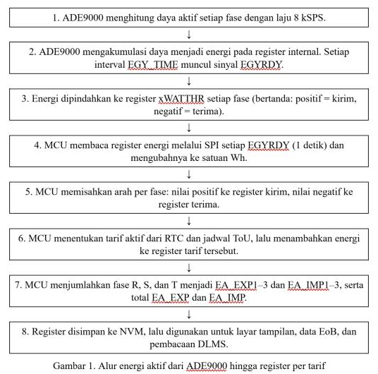
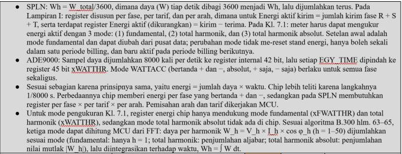

# Daily Journal – 25/11/2026

Bramantio Ananda – Metrology, Smart Meter 3-Phase AMI
Task: Revising the comparison of metrology calculations on the ADE9000 with SPLN D3.006:2021, and learning material on WBP / LWBP (energy per tariff)

## 1. Today's Work Plan

- Revise the comparison document after review: the SPLN Clause 7.1 energy modes belong to active energy (row 10), not active power (row 4).
- Prepare team learning material on WBP, LWBP1, LWBP2 and how active energy per tariff is processed from the ADE9000 to the MCU registers.
- Help answer the team's questions on I_L for TDD and on OBIS codes for harmonics.

## 2. Activities

08:00 25/11/2026 Daily team meeting via Google Meet.

08:30 25/11/2026 Monthly evaluation.

10:00 25/11/2026 Revised the comparison document: moved the explanation of the three active energy modes of SPLN D3.006:2021 Clause 7.1 (fundamental as default, total harmonic, total harmonic absolute) from row 4 (active power) to row 10 (active energy). Row 4 now only refers to row 10. The chip covers the fundamental and total harmonic modes; the total harmonic absolute mode is computed in the MCU from the FFT (algorithm in B.300 p.63–65).

10:45 25/11/2026 Rechecked rows 1–19 of the team document after the revision. Text is consistent; only the frequency question remains open.

11:15 25/11/2026 Started the WBP / LWBP learning material. Read the tariff-related parts of SPLN D3.006:2021 (display list, historical data, register naming scheme, storage clauses), the B.100–B.300 documents (tariff, RTC, NVM, FreeRTOS tasks) and the ADE9000 energy accumulation sections (data sheet p.34, UG-1098 p.24–29).

13:30 25/11/2026 Wrote the resume answering six questions: what WBP, LWBP1 and LWBP2 are and which registers are used; why LWBP is split into two; why active energy is separated into three periods; why tariffs only go up to LWBP2; how the per-tariff registers are stored; and how energy flows from the ADE9000 to the delivered / received registers per tariff. Every answer lists its source pages.

14:30 25/11/2026 Added more detail to the resume: tariff schedule handling in DLMS/COSEM (activity calendar), the effect of RTC accuracy and clock loss (ERR02) on tariff assignment, the ADE9000 energy conversion constant, and a worked example of splitting energy per phase.

Flow of active energy from the ADE9000 to the registers per tariff.

Revised explanation for active energy (row 10), including the three energy modes.

15:15 25/11/2026 Searched sources for the team's questions on I_L for TDD and on OBIS codes for harmonics. SPLN D3.006:2021 lists IEEE Std 519-1992 and IEC 62056-6-1 as normative references; IEEE 519-1992 defines I_L as the maximum demand load current (fundamental) at the PCC, recommended as the average of the preceding 12 months; IEC 62056-6-1 has standard OBIS codes for individual harmonics, THD and TDD.

## 3. Comments, Questions, Complaints

- SPLN only names Tariff 1 (WBP), Tariff 2 (LWBP1) and Tariff 3 (LWBP2) and provides registers up to Tariff 5; the ADE9000 has no tariff registers, so the split by direction and tariff is done in the MCU.
- Open questions:
  - What are the hours of WBP, LWBP1 and LWBP2? The 17.00–22.00 WBP window so far only comes from news reports, not from the tariff regulation.
  - Why is LWBP split into LWBP1 and LWBP2? No source explains it.
