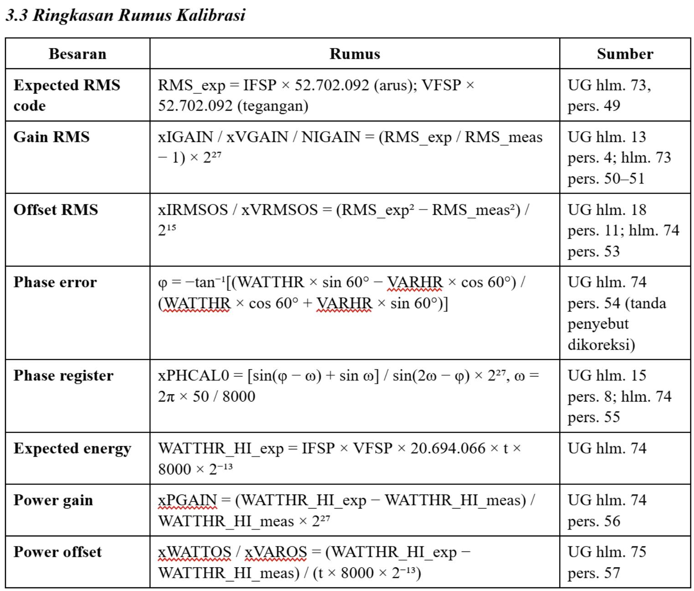

# Daily Journal – 26/11/2026

Bramantio Ananda – Metrology, Smart Meter 3-Phase AMI
Task: ADE9000 calibration procedure (gain, phase and offset for every channel) on the mock device, and follow-up on the I_L / OBIS questions

## 1. Today's Work Plan

- Finish the answers to the team's questions on I_L for TDD and on OBIS codes for harmonics, using SPLN D3.006-2:2021 and other sources.
- Review the existing ADE9000 calibration procedure and the mock device code.
- Correct and complete the calibration procedure for gain, phase and offset of every ADE9000 channel on the mock device.

## 2. Activities

08:00 26/11/2026 Daily team meeting via Google Meet.

08:25 26/11/2026 Rechecked the answers on I_L and OBIS against SPLN D3.006-2:2021 (with supplements 2022 and 2023). It has OBIS codes for THD and TDD per phase and total (E = 124 and 125), defines access levels per role, and has no object for I_L, so I_L follows IEEE Std 519 (average of the maximum demand current over the previous 12 months). Cross-checked with other references and wrote the full answers with sources.

10:00 26/11/2026 Started the ADE9000 calibration procedure for the mock device. Reviewed the existing draft procedure, the mock device code (Mock, RegisterMap), the ADE9000 data sheet, the UG-1098 reference manual (calibration section p.73–76) and the ADE9000 Calibration Tool.

13:00 26/11/2026 Wrote the corrections: formulas for every calibration register (gain, RMS offset, phase, power gain, power offset), the neutral channel and fundamental offsets, register setup before calibration, the calculation model the mock needs, and test numbers based on the UG-1098 example, recomputed at full precision.

15:00 26/11/2026 Merged the corrections into the existing procedure, keeping its format and section numbering, and added a revision table. Uploaded the document to Google Drive.

Summary of the calibration formulas used in the procedure.

## 3. Comments, Questions, Complaints

- The current mock device only accepts writes to the RUN register and has no gain, offset or phase model, so the calibration cannot be run on it yet. The procedure lists what needs to be added.
- The phase error formula in UG-1098 (eq. 54) is printed with a "−" in the denominator, but the worked example and the Calibration Tool use "+". The procedure uses "+".
- The conversion constants in the metrology program are still the UG-1098 example values (10 A, 220 V) and need to be recalculated for the meter hardware.
- Open questions:
  - What are the final CT ratio, burden resistor and voltage divider values? They are needed to calculate IFSP, VFSP and the conversion constants.
  - SPLN D3.006 SUP-2:2023 defines "energi aktif total" as delivered + received, while Lampiran I uses delivered − received. Which one should the meter use?
