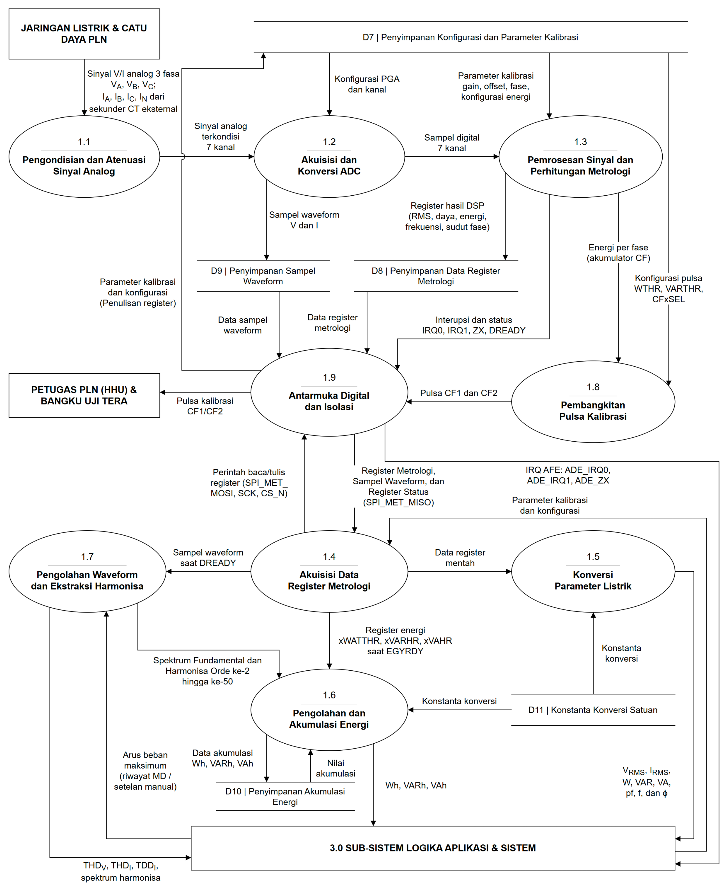

# Daily Journal – 27/11/2026

Bramantio Ananda – Metrology, Smart Meter 3-Phase AMI
Task: Revise the Data Flow Diagram (DFD) Level 2 Part 1.0 (Metrology and DSP subsystem) in B.300

## 1. Today's Work Plan

- Get the latest B.100–B.400 documents and review the DFD Level 2 Part 1.0 against them.
- Correct the data flows of the DFD and make it consistent with DFD Level 1.
- Rearrange the layout so the diagram stays readable when inserted into B.300 on Google Docs.

## 2. Activities

08:00 27/11/2026 Daily team meeting via Google Meet.

08:25 27/11/2026 Saved the latest B.100, B.200 and B.300 from Google Drive (B.400 unchanged) and reviewed the DFD Level 2 Part 1.0 in draw.io. Cross-checked it with DFD Level 0, Level 1, Level 2 Parts 2.0 and 3.0, the metrology program description and the Subsystem 1 hardware signal names in B.300.

10:00 27/11/2026 Listed the corrections: energy data did not leave process 1.0, energy was accumulated from power instead of the ADE9000 energy registers, the CF pulses came from the MCU instead of the ADE9000, the calibration data flowed in the wrong direction, one data store was never read, TDD had no I_L input, and some entity, output and signal names did not match DFD Level 1 and B.300.

11:00 27/11/2026 Redrew the DFD in the hardware order (ADE9000, then SPI isolator, then MCU), kept the process numbers 1.1–1.9, renumbered the data stores D7–D11 and wrote a change list with the reason for each change.

13:00 27/11/2026 Rearranged the layout from landscape (about 2700 × 1550 px) to portrait (about 1180 × 1410 px) with larger text, so it can be read at Google Docs page width without zooming, and updated the "Revisi DFD" page in the team draw.io file.

15:00 27/11/2026 Wrote an explanation of the overall data flow of the revised DFD for the team, then applied 12 label corrections from the review (subscripts, shorter store names, "Spektrum Fundamental dan Harmonisa Orde ke-2 hingga ke-50", and others) and saved the updated diagram.

Revised DFD Level 2 Part 1.0 (Metrology and DSP subsystem).

## 3. Comments, Questions, Complaints

- The DFD figure in B.300 is still the old landscape version and needs to be replaced with the new export.
- D11 (conversion constants) has no incoming flow in the diagram; it is treated as fixed design values.
- Open questions:
  - DFD Level 1 has no flow for calibration and configuration parameters from 3.0 to 1.0. Should it be added so Level 1 and Level 2 balance?
  - DFD Level 2 Part 2.0 uses a flow from 1.0 to 2.0, but DFD Level 1 has no such flow. Which one is correct?
