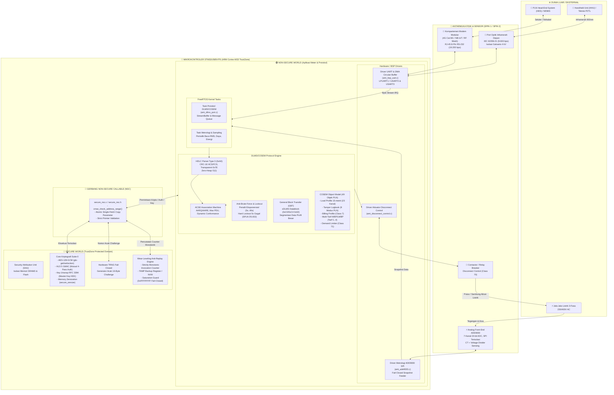
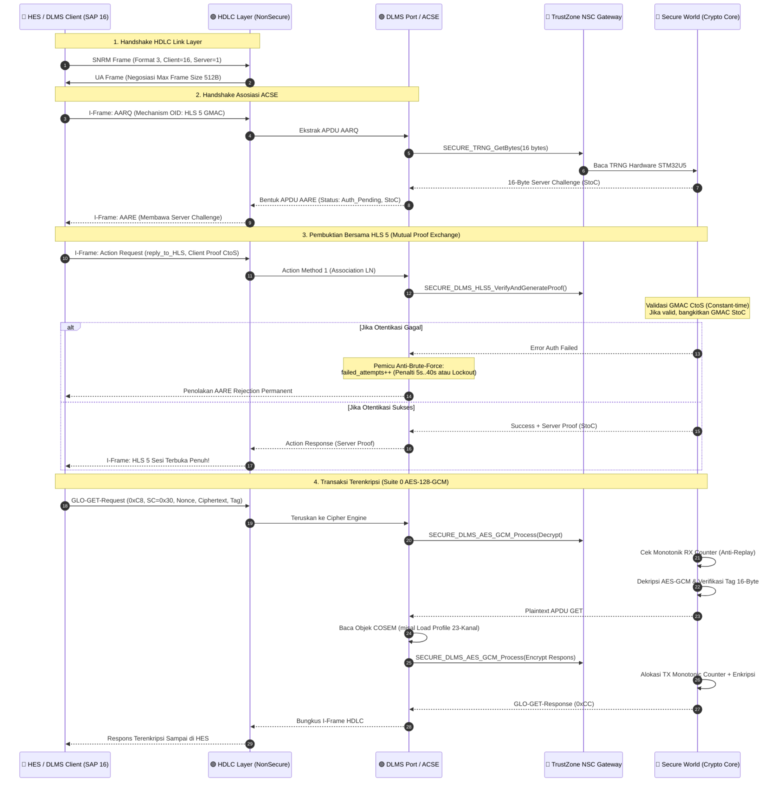
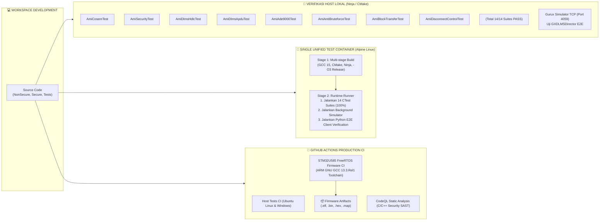

# 📐 Diagram Arsitektur Lengkap Sistem Smart Meter 3-Fasa AMI
**Target: STM32U585VIT6 (ARM Cortex-M33 TrustZone) + ADE9000 AFE**  
*Kepatuhan Standar: SPLN D3.006:2021, SPLN D5.002:2024, IEC 62056 (DLMS/COSEM)*

---

## 1. Diagram Blok Sistem End-to-End (Topologi Fisik & Logika)

---

## 2. Diagram Aliran Data Protokol & Otentikasi HLS5 (GMAC)

---

## 3. Diagram Struktur Pengujian & CI/CD Pipeline

